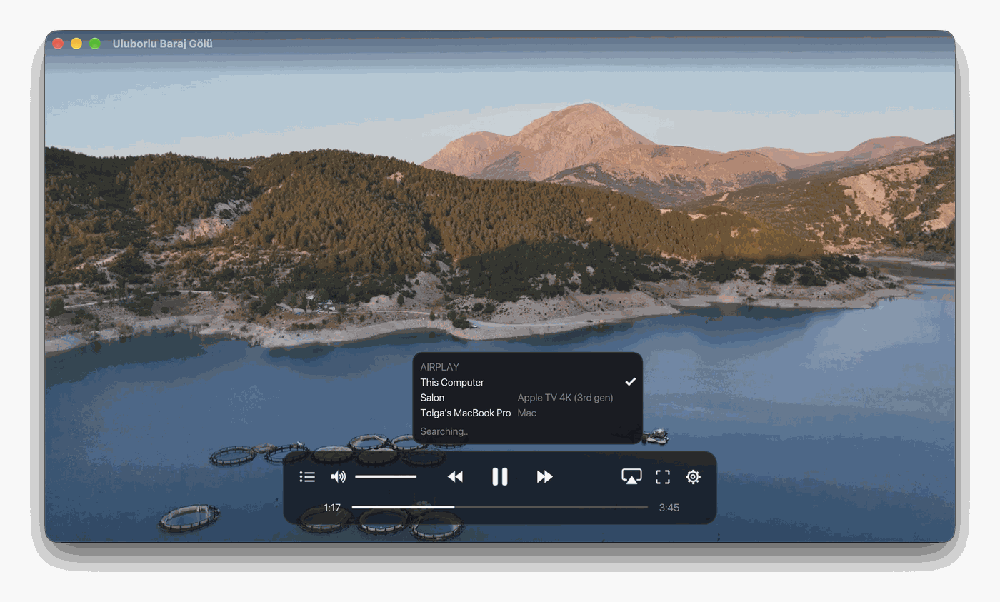
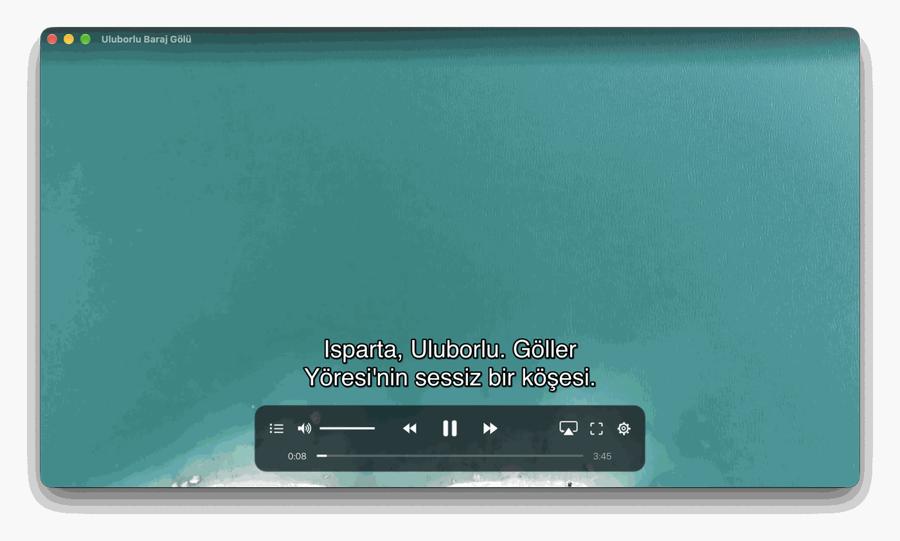
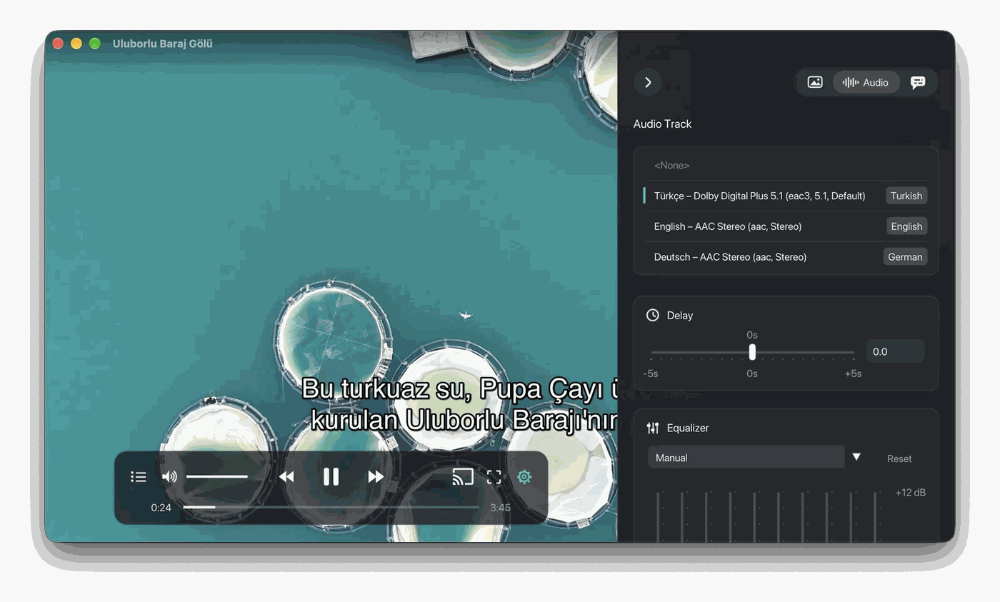
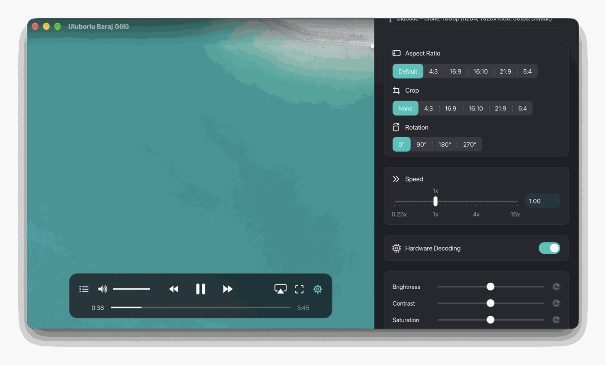
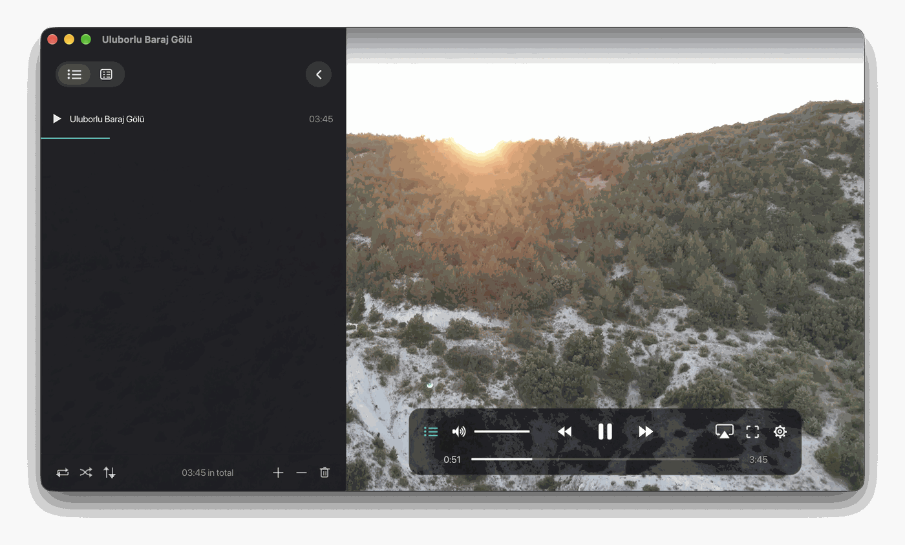

# Tolga Player

A small, good-looking video player for macOS, Windows and Linux that also sends any movie
to an Apple TV over AirPlay (MKV, DTS, every audio language and subtitle).
libmpv (playback) + SDL3 (window, GL context, file dialog) + Dear ImGui (controls).

**Download:** [Mac (Apple Silicon and Intel)](https://github.com/cctolga/tolga/releases/latest/download/Tolga-Player-Mac.dmg) ·
[Windows 10/11](https://github.com/cctolga/tolga/releases/latest/download/Tolga-Player-Win.exe) ·
[Linux (AppImage)](https://github.com/cctolga/tolga/releases/latest/download/Tolga-Player-Linux.AppImage) ·
[website](https://cctolga.github.io/tolga/)



| | |
|---|---|
|  |  |
| Playback with subtitles | Audio tracks and equalizer |
|  |  |
| Video settings | Playlist |

## Build on macOS

```sh
brew install mpv pkg-config cmake sdl3     # sdl3 is optional; CMake fetches it if missing
cmake -S . -B build
cmake --build build -j
./build/tolga ~/Movies/some-video.mkv
```

## Build on Linux

```sh
# Debian/Ubuntu (other distributions: the same packages under their names)
sudo apt install build-essential cmake ninja-build pkg-config libmpv-dev libcurl4-openssl-dev \
     libx11-dev libxext-dev libxrandr-dev libxcursor-dev libxi-dev libxss-dev libxkbcommon-dev \
     libwayland-dev wayland-protocols libdecor-0-dev libegl-dev libasound2-dev libpulse-dev
cmake -S . -B build
cmake --build build -j
./build/tolga ~/Videos/some-video.mkv
```

The distribution's mpv is a GPL build: fine for your own use, but a build you give to others
uses the LGPL libraries below (`scripts/make-appimage.sh`).

## Build for Windows

Windows builds are cross-compiled on Linux (or WSL) with MinGW-w64; see
[Windows installer](#windows-installer) below. The result runs on 64-bit Windows 10 and 11.

## Release build (Tolga Player.app + .dmg)

The development build above uses Homebrew's mpv and ffmpeg. Those are GPL builds, so they
must not be shipped together with the closed-source AirPlay module. A release uses LGPL builds made from source:

```sh
brew install meson ninja nasm pkg-config cmake
scripts/build-deps.sh      # once: FFmpeg (LGPL), libmpv (-Dgpl=false), libplacebo, libass, ... (~20-30 min)
scripts/make-app.sh        # dist/Tolga Player.app and dist/Tolga-Player-Mac.dmg
```

`build-deps.sh` puts everything in `deps/darwin-<arch>/` and stops with an error if FFmpeg or
libmpv came out as GPL. `make-app.sh` copies only those libraries (plus `ffmpeg`/`ffprobe`
for seek previews and AirPlay) into the bundle, rewrites their load paths, fails if anything
from Homebrew would be loaded, adds the license texts (`Contents/Resources/Licenses`,
`THIRD_PARTY_NOTICES.txt`) and builds the disk image. OpenSSL and SDL are linked statically.

Without a Developer ID the app is signed ad hoc, which is enough on your own Mac. To give it
to others it has to be signed and notarized (Apple Developer Program):

```sh
xcrun notarytool store-credentials tolga-notary --apple-id you@example.com --team-id TEAMID
TOLGA_SIGN_ID="Developer ID Application: Your Name (TEAMID)" \
TOLGA_NOTARY_PROFILE=tolga-notary scripts/make-app.sh
```

### Linux AppImage

```sh
# Ubuntu 22.04 or newer, plus the packages listed at the top of scripts/build-deps.sh
scripts/build-deps.sh      # once: the same LGPL libraries, plus a static curl (HTTPS only)
scripts/make-appimage.sh   # dist/Tolga-Player-Linux.AppImage
```

The AppImage carries its libraries in `usr/lib`; only what must match the user's system
(C/C++ runtime, graphics drivers, X11/Wayland, ALSA/PulseAudio, fontconfig) comes from
the distribution. It runs on distributions with the same or a newer glibc than the build
machine, so release builds are made on Ubuntu 22.04 by `.github/workflows/linux.yml`:
a tag `v*` attaches `Tolga-Player-Linux.AppImage` to that release. Release files keep the
same name in every version (`Tolga-Player-Mac.dmg`, `Tolga-Player-Win.exe`,
`Tolga-Player-Linux.AppImage`), so the website's `releases/latest/download/...` links always
point to the newest one.

### Windows installer

Cross-compiled on Linux with MinGW-w64 (no Windows machine needed for the build):

```sh
sudo apt install g++-mingw-w64-x86-64-posix mingw-w64-tools nsis zip meson ninja-build nasm cmake
TOLGA_TARGET=windows scripts/build-deps.sh   # once: the LGPL libraries as Windows DLLs
scripts/make-windows.sh                      # dist/Tolga-Player-Win.exe (installer) and .zip
```

The installer (NSIS) installs for the current user only, into
`%LOCALAPPDATA%\Programs\Tolga Player`, without administrator rights, and adds Tolga Player to
the Start menu and to "Open with" for video files. `.github/workflows/windows.yml` builds it
on every tag `v*` and attaches `Tolga-Player-Win.exe` and `Tolga-Player-Win.zip` to that release.

Other knobs: `TOLGA_BUY_URL` (shop page behind "Buy Tolga"), `TOLGA_SOURCE_URL` (where the
source is, for the notices), `TOLGA_BUNDLE_ID` (default `app.tolga.player`), `MACOSX_DEPLOYMENT_TARGET`
(default 12.0; set it before `build-deps.sh` too), `TOLGA_BUILD_NUMBER`.

## License and AirPlay

The Tolga player is open source under the Apache License 2.0 (`LICENSE`, `NOTICE`).
Anyone may build, use, change and share it, also in their own products.

AirPlay (playing on an Apple TV) is a separate, **closed-source** module. The player only
talks to it through `include/tolga/AirPlayApi.h`. On macOS, Windows x86_64 and Linux x86_64,
CMake downloads the prebuilt module (`libtolga_airplay.dylib`, Apple Silicon + Intel;
`tolga_airplay.dll`; `libtolga_airplay.so`) from this repository's releases and checks it against the SHA-256 in `cmake/AirPlayPrebuilt.cmake`. AirPlay then works for
14 days and afterwards needs a Tolga license (https://cctolga.github.io/tolga/).

- `-DTOLGA_AIRPLAY_PREBUILT=OFF` builds without AirPlay (also on other systems, e.g. Linux on
  ARM); the AirPlay menu then points to the official app.
- The download happens once per build folder; offline, the build continues without AirPlay.

## Controls

| Key / action        | Function                 |
|---------------------|--------------------------|
| Space               | Play / pause             |
| Left / Right        | Seek -5 s / +5 s         |
| Up / Down           | Volume +5 / -5           |
| M                   | Mute                     |
| F, double-click     | Toggle fullscreen        |
| Esc                 | Leave fullscreen         |
| Cmd+O / Ctrl+O      | Open file                |
| Cmd+Q / Ctrl+Q      | Quit                     |
| Drag & drop         | Open file (.srt etc. is added as subtitle) |
| V                   | Show / hide subtitles    |
| J                   | Next subtitle track      |
| S                   | Subtitles panel          |
| A                   | Audio panel              |
| P                   | Playlist                 |
| N                   | Next video in the playlist |

## AirPlay

The AirPlay button in the control bar lists AirPlay receivers on the local network.
Devices that can't play video (HomePod) are greyed out. In builds without the AirPlay
module the menu only offers this computer and a link to the official app.
AirPlay is free to try for 14 days; "Enter License..." in the AirPlay menu takes a key.

Pick an Apple TV and the current video continues there from the same position:

- The first time, the TV shows a 4-digit code; type it into the "Pair with ..." dialog.
  The pairing is saved (readable only by you) in `~/Library/Application Support/Tolga/`
  (macOS), `~/.local/share/Tolga/` (Linux) or `%APPDATA%\Tolga\` (Windows).
- While casting, the control bar is a remote: play/pause (button or Space), the seek bar,
  the ±10 s buttons and the arrow keys work on the TV. Volume stays with the TV remote.
- Choose **This Computer** in the AirPlay menu to continue locally from where the TV was.
- Any video in H.264 or HEVC can be cast, whatever the container (MP4, MOV, MKV, TS,
  AVI...). Other video codecs are refused with a message, because they would need
  re-encoding. Audio the Apple TV can't play (DTS, TrueHD, FLAC, Opus...) is converted;
  surround stays surround.
- Audio tracks and subtitles can be switched in Tolga or with the Siri Remote, and the
  two stay in step. The subtitle delay reaches the TV too.

On macOS the first start may ask for **Local Network** access (for Terminal, if you
start it from there). Allow it, otherwise no devices are found. On Windows the firewall may
ask whether Tolga Player may use private networks: allow it, the Apple TV fetches the video
from Tolga Player.

## Window

Drag anywhere on the video to move the window (a plain click or double-click still works
as before). On macOS the title bar is transparent over the video and fades out together
with the controls.

## Seek bar preview

Hovering over the seek bar shows a small picture of that moment (like IINA). When a local
file opens, ffmpeg reads only its keyframes in the background and keeps one small frame
every few seconds (at most 240 per file); previews appear as they become ready. Streams
(http URLs) have no preview.

## Playlist

The list button at the left of the control bar, next to the volume (or P), opens the playlist. Videos dropped on
the window, picked with "+", opened together (Cmd+O lets you select several) or given on the
command line (`tolga a.mp4 b.mp4`) go into it. Double-click plays a video, drag rows to
reorder, "-" removes the selected one, the bin clears the list (the playing video stays).
Each row shows the length and a blue bar for how far it was watched. Footer: repeat
(off / playlist / this video), shuffle, sort by name, total length. The second tab lists
the video's chapters. While casting, the next video goes to the Apple TV too.

## Audio / subtitle panel

The settings button (gear, right of the control bar) opens the side panel with the Video,
Audio and Subtitles tabs (S and A open those tabs directly). It also has:
- **Delay** for audio and for subtitles: drag the slider (-5..+5 s, double-click = 0) or
  type an exact value. Handy when a downloaded subtitle is a little early or late.
- **Equalizer**: 10 bands from 32 Hz to 16 kHz (±12 dB) with presets (Bass Booster,
  Vocal Booster, Rock, ...). Double-click a band to reset it, Reset sets all to 0.
  While casting, the subtitle delay also reaches the Apple TV (the subtitles are rewritten
  and the video continues from the same place after a short pause). Audio delay and the
  equalizer only work on this computer, so they are greyed out while casting, together
  with anything else the TV can't do (video track, volume, and track lists when the file
  was sent without HLS).

The **Video** tab has aspect ratio override, crop (centred, to 4:3 / 16:9 / 16:10 / 21:9 /
5:4), rotation, playback speed (0.25x-16x, double-click = 1x), hardware decoding on/off and
brightness / contrast / saturation / gamma / hue (double-click or the round button resets).
Aspect, crop, rotation, speed and picture settings start fresh with every new file.
These only apply on this computer and are greyed out while casting.

## Online subtitles

**Search Online...** in the subtitles panel (S) searches OpenSubtitles.com for the current
file: by its OpenSubtitles hash (results marked "Exact match" were made for exactly this
file) and by a title guessed from the file name, in the languages you set (default `tr,en`).
Pick a result and press DOWNLOAD; the subtitle is added and shown right away (and goes to
the Apple TV too while casting).

Official builds have Tolga's own API key built in, so nobody is asked for one. The key is
never in the source: it comes from an `opensubtitles.key` file next to `CMakeLists.txt`
(in `.gitignore`) or `cmake -DTOLGA_OPENSUBTITLES_KEY=...`. Builds without it ask for the
user's own free API key (opensubtitles.com > Consumers) under Account.
Logging in there with an opensubtitles.com user name and password is optional and raises
the daily download limit. The settings are stored in
`opensubtitles.json` in the app data folder, readable only by your user; downloaded
subtitles go to its `Subtitles/` folder.

Building needs libcurl (included with macOS; on Linux `libcurl4-openssl-dev`, or the static
one from `scripts/build-deps.sh`, which on Windows uses the system's TLS, Schannel).

## Troubleshooting

`TOLGA_MPV_LOG=v ./build/tolga file.mkv` prints verbose mpv logs.

## Layout

- `src/MpvPlayer.*`  wrapper around libmpv and its OpenGL render API
- `src/Overlay.*`    ImGui controls: floating bar, side panel, playlist, dialogs
- `src/OpenSubtitles.*`  OpenSubtitles.com search and download
- `src/Thumbnailer.*`, `src/DurationCache.*`, `src/Ffmpeg.*`  seek previews and file lengths (ffmpeg/ffprobe)
- `include/tolga/AirPlayApi.h`  interface to the AirPlay module
- `cmake/AirPlayPrebuilt.cmake`  version, URL and SHA-256 of the prebuilt AirPlay module
- `src/AirPlayNone.cpp`  stand-in when the build has no AirPlay module
- `src/main.cpp`     window, event loop, keyboard shortcuts
- `src/Subprocess.h`, `src/Paths.h`  running ffmpeg/ffprobe and UTF-8 paths on every system
- `resources/windows/`  icon, manifest, version info and installer (NSIS) for Windows
- `scripts/build-deps.sh`, `make-app.sh`, `make-windows.sh`, `make-appimage.sh`  release builds
- `tests/fake/fake_opensubtitles.py`  fake OpenSubtitles API for testing
